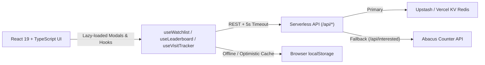

# Avengers: Doomsday — Campus Watch-Party & Interactive Experience

An interactive, full-stack **Avengers: Doomsday** campus watch-party web app built with **React 19, TypeScript, Tailwind CSS v4, custom WebGL/Canvas effects, and Serverless APIs**.

Designed to turn movie hype into a real campus coordination tool—complete with character dossiers, a live RSVP watchlist, and a 30-second arcade mini-game with a persistent leaderboard.

> **Live Demo:** `[Add your Vercel/Netlify URL here]`  
> **Demo Video / Preview:** `[Add screenshot or GIF here]`

---

## Features

- **Interactive Character Dossiers**
  - Switch between character profiles (Doctor Doom, Thor Odinson, Captain America, and more) with dynamic accent themes, quotes, threat levels, and faction intel.
  - Supports scroll-wheel, touch-swipe, and keyboard navigation, plus `prefers-reduced-motion` accessibility support.
- **Custom WebGL & Canvas Atmosphere**
  - Real-time ember, smoke, and lightning effects (`DoomsdayWebGLScene`, `AtmosphericCanvas`, `ThorLightning`) that react to character transitions and user actions.
- **Campus Watchlist & RSVP System**
  - Students can mark interest, RSVP for **Dec 17** or **After Dec 17**, select group size (`Solo`, `+1`, `Squad 3+`), and filter the live campus roster.
  - Includes input sanitization, `O(N)` timestamp-precomputed roster deduplication, and optimistic local-storage caching.
- **30-Second Doomsday Mini-Game & Leaderboard**
  - Built-in arcade bubble-popping mini-game with hero/villain targets, combo multipliers, bomb hazards, and a live campus leaderboard.
- **Performance-First Frontend**
  - Modals (`TrailerModal`, `InterestModal`, `WatchlistModal`, `DoomsdayGameModal`) are code-split with `React.lazy` + `Suspense` and wrapped in an `ErrorBoundary`.

---

## Tech Stack

| Layer | Technologies |
| :--- | :--- |
| **Frontend** | React 19, TypeScript, Vite, Tailwind CSS v4, Lucide React |
| **Graphics & FX** | Custom WebGL (`DoomsdayWebGLScene`), HTML5 Canvas (`AtmosphericCanvas`) |
| **Backend (Serverless)** | Node.js HTTP handlers (`/api/interested`, `/api/leaderboard`, `/api/visit`) |
| **Database & Fallback** | Upstash / Vercel KV Redis (Primary), Abacus Counter API & `localStorage` (Fallback) |

---

## Architecture



---

## Project Structure

```text
├── api/
│   ├── interested.ts        # Watchlist counter & campus RSVP roster API (Redis + Abacus fallback)
│   ├── leaderboard.ts       # Mini-game high-score & leaderboard API
│   └── visit.ts             # Bot-filtered visit counter API
├── public/                  # Static assets, fonts, and character artwork
├── src/
│   ├── components/          # UI sections, WebGL/Canvas FX, and lazy-loaded modals
│   ├── data/                # Character dossier profiles
│   ├── hooks/               # Custom hooks (watchlist, leaderboard, modal behavior, visit tracker)
│   ├── types/               # TypeScript interfaces for game & watchlist state
│   ├── utils/               # Sanitization, storage helpers, and atmosphere presets
│   └── App.tsx              # Main application shell & navigation state
├── package.json
└── vite.config.ts
```

---

## Run Locally

### Prerequisites
- **Node.js** (v18+ recommended)
- **npm**

### 1. Clone & Install
```bash
git clone https://github.com/<your-username>/<your-repo-name>.git
cd <your-repo-name>
npm install
```

### 2. Environment Variables (Optional)
The frontend works out of the box with local fallback storage. To enable persistent Redis storage for the serverless `/api/*` endpoints, add a `.env.local` file:
```env
KV_REST_API_URL=your_upstash_or_vercel_kv_url
KV_REST_API_TOKEN=your_upstash_or_vercel_kv_token
```
*(Also supports `UPSTASH_REDIS_REST_URL` and `UPSTASH_REDIS_REST_TOKEN`.)*

### 3. Start Development Server
```bash
npm run dev
```
The app will be available at `http://localhost:3000`.

### 4. Type-Check & Build
```bash
npm run lint    # Runs tsc --noEmit
npm run build   # Builds production bundle to dist/
npm run preview # Previews the production build locally
```

---

## License

This project is licensed under the **Apache-2.0** License.
